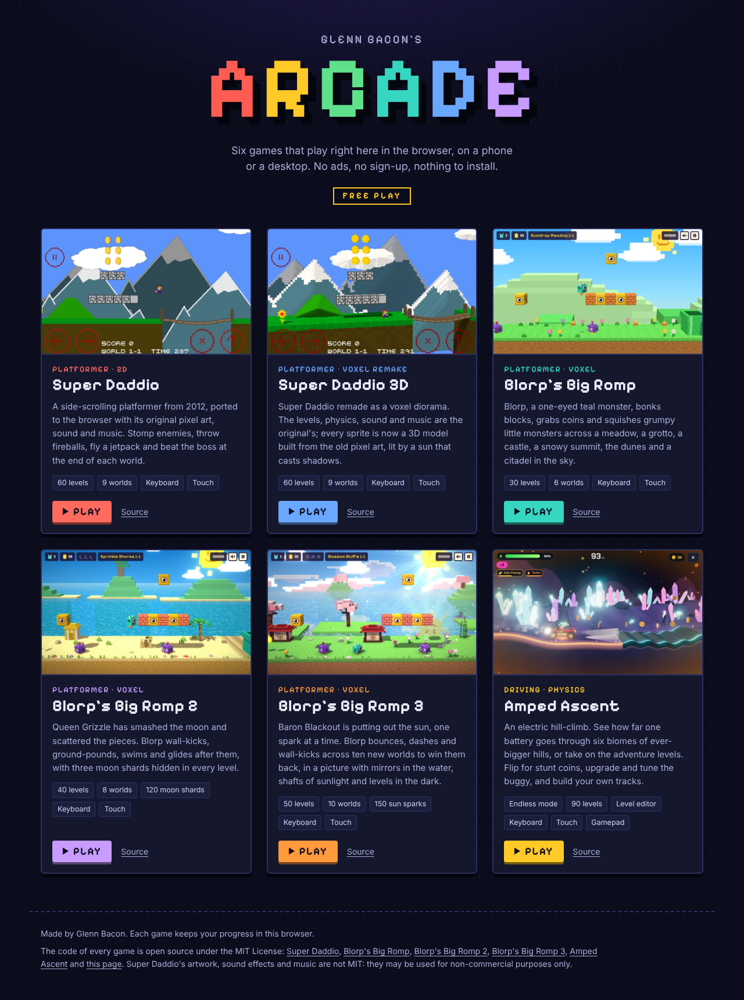

# Arcade

Five games by Glenn Bacon that play in the browser, on a phone or a desktop, with nothing to install.

**[Open the arcade](https://glennbacon.github.io/arcade/)**



## The games

| Game | What it is | Play | Source |
|---|---|---|---|
| **Super Daddio** | A side-scrolling platformer from 2012, ported to the browser. 60 levels across nine worlds. | [Play](https://glennbacon.github.io/arcade/super-daddio/) | [superdaddio](https://github.com/glennbacon/superdaddio), in `web/` |
| **Super Daddio 3D** | The same game remade as a voxel diorama. | [Play](https://glennbacon.github.io/arcade/super-daddio-voxel/) | [superdaddio](https://github.com/glennbacon/superdaddio), in `voxel/` |
| **Blorp's Big Romp** | A voxel platformer. Six worlds, thirty levels and a map to walk between them. | [Play](https://glennbacon.github.io/arcade/blorps-big-romp/) | [blorps-big-romp](https://github.com/glennbacon/blorps-big-romp) |
| **Blorp's Big Romp 2** | Its sequel. Eight worlds, forty levels and 120 moon shards to find. | [Play](https://glennbacon.github.io/arcade/blorps-big-romp-2/) | [blorps-big-romp2](https://github.com/glennbacon/blorps-big-romp2) |
| **Amped Ascent** | An electric hill-climb driving game. Endless runs, a 90-level adventure, a garage and a level editor. | [Play](https://glennbacon.github.io/arcade/amped-ascent/) | [AmpedAscent](https://github.com/glennbacon/AmpedAscent) |

## What is where

This is a plain static site. GitHub Pages serves the repository as it is; the page itself has no
build step and no scripts.

| Path | What it holds |
|---|---|
| `index.html` | The arcade page, with its styles |
| `assets/` | The picture on each game's card, and the picture shown when a link to the arcade is shared |
| `super-daddio/`, `super-daddio-voxel/`, `blorps-big-romp/`, `blorps-big-romp-2/`, `amped-ascent/` | A built copy of each game |
| `build.sh` | Rebuilds those copies from the games' repositories |
| `versions.txt` | The commit of its repository that each copy was built from |
| `.github/workflows/update-games.yml` | Runs `build.sh` every half hour, for the games that have changed |
| `screenshot.png` | The picture at the top of this page |
| `.nojekyll` | Tells GitHub Pages to publish the files untouched |

The games are developed in their own repositories. The five folders here hold only what their
builds produce, so do not edit them by hand: change the game in its repository, and its copy here
follows.

## How the games stay up to date

A workflow, [`update-games.yml`](.github/workflows/update-games.yml), runs every half hour. It asks
GitHub for the newest commit on the default branch of each game's repository and compares it with
`versions.txt`. A game whose repository has moved on is rebuilt from that branch and committed here
by `github-actions[bot]`, and GitHub Pages publishes the commit. So a change that reaches a game's
default branch is in the arcade about half an hour later, with nothing to do by hand.

- **To update at once**, open this repository's **Actions** tab, choose **Update games** and press
  **Run workflow**. Ticking *Rebuild every game* rebuilds them all, changed or not.
- **Only the default branch counts.** Work on a game's other branches is not published.
- **If a game does not build**, its old copy stays, the other games are still updated, and the run
  shows as failed in the Actions tab. The next run tries again.
- **If the games stop updating**, look at **Update games** in the Actions tab. GitHub switches off
  scheduled workflows in a public repository that has had no activity for 60 days; a button there
  switches it back on.

The workflow builds in one job and commits in another. The job that builds runs the games' code and
everything they depend on, so it may only read this repository; the job that may write to it runs
none of that, and replaces nothing but the games' folders and `versions.txt`.

## Updating a game by hand

```bash
./build.sh                 # every game, from the copies of the repositories on this machine
./build.sh amped-ascent    # only the ones named
./build.sh --latest        # what the workflow runs: only the games that have changed on GitHub
./build.sh --latest all    # every game, from GitHub, changed or not
```

This needs bash, git and [Node.js](https://nodejs.org/) 22 or newer.

Without `--latest`, the script looks for the game repositories next to this one (`../superdaddio`,
`../blorps-big-romp`, `../blorps-big-romp2`, `../AmpedAscent`); set `GAMES_DIR` to look somewhere
else. A repository that is not there is cloned from GitHub into `.sources/`, which git ignores. It
builds whatever is checked out, which is the way to try a branch of a game inside the arcade before
merging it.

With `--latest`, it leaves the repositories on this machine alone and builds from a fresh clone of
each default branch.

To look at the site, serve this folder and open <http://localhost:8000>:

```bash
python3 -m http.server
```

To publish what you built, commit the folders that changed, with `versions.txt`, and push.

## Adding a game

1. In `build.sh`, add its name to `ALL_GAMES` and its repository to `repo_of`. If it is built with
   Vite rather than kept as one built `index.html`, give it a line in `build` as well.
2. Put an 800 × 480 picture of it in `assets/`.
3. Copy one of the `<li class="game">` blocks in `index.html`, and change the picture, the text, the
   links and `--accent`, the card's colour.

The cards sit three to a row with the last row centred. That is written for five cards: with a
different number, change the `.game:nth-child` rules in the page's styles.

## Publishing

In the repository's settings on GitHub, under **Pages**, choose **Deploy from a branch**, pick the
branch and the folder `/ (root)`. The site is then at <https://glennbacon.github.io/arcade/>, and
each game at its folder's name under that.

## Licence

**The arcade page and `build.sh` — MIT.** See [`LICENSE`](LICENSE).

**The games.** Each game's folder is a build of its repository and comes under that repository's
licence. The code of all of them is MIT.

**Super Daddio's artwork, sound effects and music — not MIT.** They are in `super-daddio/` and
`super-daddio-voxel/`, and the pictures of the two games in `assets/` and `screenshot.png` show them.
They belong to Glenn Bacon and may be used for non-commercial purposes only; the terms are in
[`LICENSE-ASSETS.md`](https://github.com/glennbacon/superdaddio/blob/main/LICENSE-ASSETS.md) in the
Super Daddio repository.

**Other people's work.** The built games include [three.js](https://github.com/mrdoob/three.js) and
[planck.js](https://github.com/piqnt/planck.js), both MIT, and Super Daddio includes the "Pixelated"
typeface, copyright © 2007 Galactic Federation Fontworks. The two Blorp games load three.js and
their fonts from CDNs; the arcade page loads [Pixelify Sans](https://fonts.google.com/specimen/Pixelify+Sans)
(SIL Open Font License) from Google Fonts.
